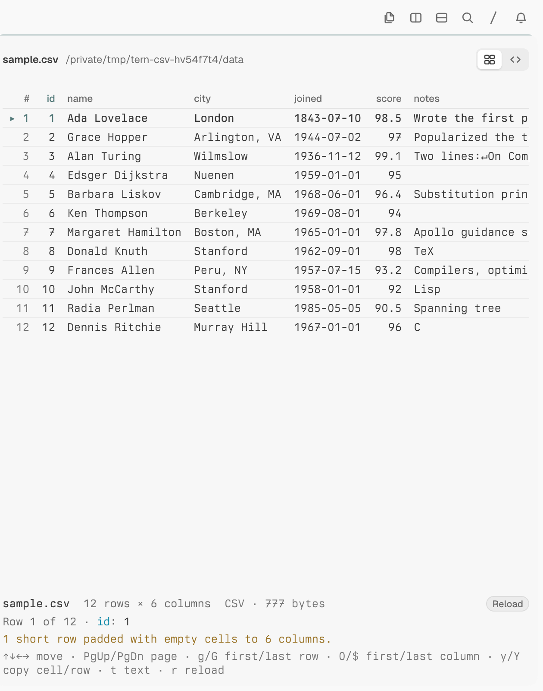
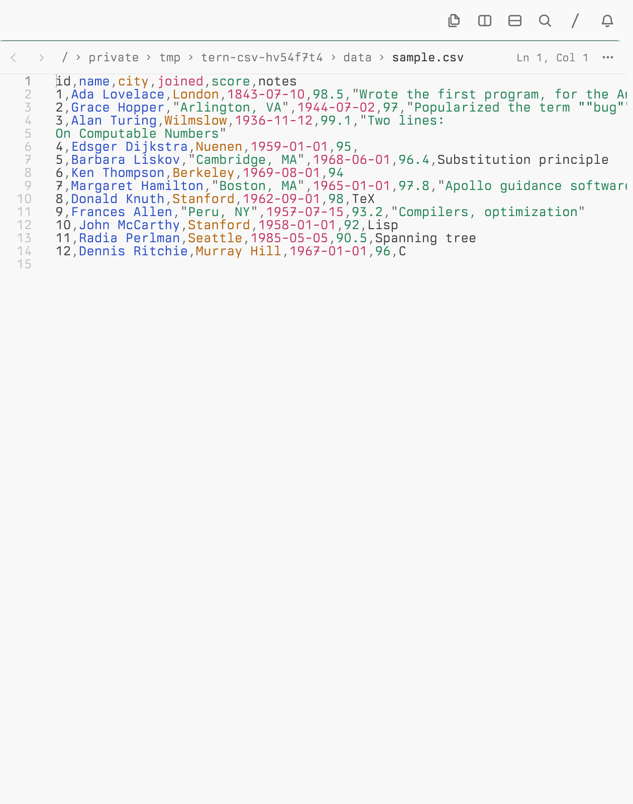
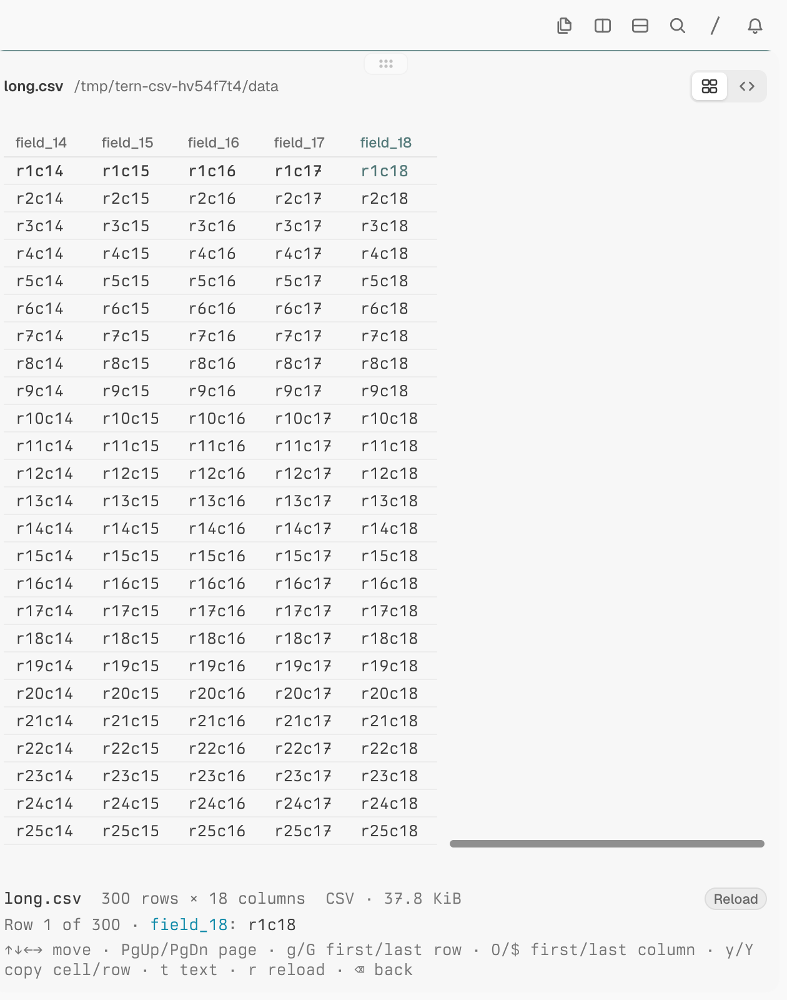

# csv

A Tern plugin: a **CSV Table** block (kind `csv.table`) that shows a CSV or
TSV file as a native, keyboard-driven table, with a **Table | Text** switch
in its top-right corner, the way Tern's file block offers **Rendered |
Source** for Markdown.

| Table | Text (Tern's editor) | Wide file, scrolled right |
| --- | --- | --- |
|  |  |  |

- A file opens on **Table**. **Text** (or `t`) puts Tern's own file block
  for the same file, the editable one a plain `.csv` opens in, in the
  table's place. **Show CSV as table** (`⌃⌥T`, or the palette) puts the
  table back in the file block's place. A file block can't hold the switch
  itself (see below), so on that side the way back is the command.
- RFC 4180 parsing: quoted fields with commas, line breaks and `""`
  quotes; CRLF, LF or CR line ends; a UTF-8 BOM. `.tsv`/`.tab` files are
  tab-separated. The first row is the header; short rows are padded (and
  counted in the dock); blank header cells become `Column N`.
- Every row (up to 2,000 around the cursor) and every column is drawn, so
  the table fills the pane and scrolls natively both ways: a horizontal
  scrollbar, trackpad and wheel; the header stays aligned with the rows.
  Numeric columns are right-aligned; cells are cut at 40 characters (the
  dock shows the cursor cell in full).
- Moving the cursor up or down scrolls its row into view. Moving it sideways
  (`h` `l` `0` `$`) does not scroll: columns aren't nodes the block can
  scroll to, so scroll sideways with the scrollbar or trackpad.
- The dock shows the file name, row and column counts, size, the cursor
  cell's column and full value, and notices (padded rows, Latin-1 input).
- Missing, unreadable, empty, oversize (over 4 MiB) and malformed files get
  an error card; parse errors show the line and column with an excerpt.

## Keys

| Key | Does |
| --- | --- |
| `↑` `↓` `←` `→` / `h` `j` `k` `l` | Move the cursor cell (up and down, the pane scrolls to its row) |
| `PageUp` / `PageDown` (`Space`) | Page through the rows |
| `Home` `End` / `g` `G` | First / last row |
| `0` / `$` | First / last column |
| `y` / `Y` | Copy the cell / the row (as a CSV line) |
| `t` | Text: Tern's file block in the table's place (as clicking the switch does) |
| `r` | Reload the file |
| `Backspace` | Back to the folder the file was picked from |

In a file block showing a `.csv`, `.tsv` or `.tab` file, `⌃⌥T` (**Show CSV
as table**) swaps the table back in. It asks you to save first when the file
has unsaved edits, since the table reads the file from disk.

In the folder picker: `↑` `↓` choose, `Enter` opens, `r` rescans, and a
pasted path opens that file.

## Opening it

- Every open of a `.csv`, `.tsv` or `.tab` file goes to the table: the
  Files pane, the palette, drops, `tern open`, links and paths ⌘-clicked in
  a terminal, preview and in-place opens (an in-place open swaps the table
  into that pane; a preview opens it beside, since a route can't place a
  plugin block as a preview). A line-targeted open (`file.csv:5`) puts the
  cursor on the row holding that line. Only the Text switch reaches Tern's
  editor: opens a plugin makes skip the routes. Tern doesn't route the Files
  pane's own preview, so that one still shows the editor.
- **Open with › CSV Table** in the menu of a matching file.
- **Open CSV…** in the palette: opens the focused file block's CSV beside
  it, or lists the CSV and TSV files in the focused pane's folder.

What is Tern's and what isn't. Markdown's Rendered | Source switch is part
of Tern's file block: its two modes are one pane, its buttons run no command
a plugin can hook, and no plugin API adds a mode, a toolbar button or a pane
header button to the file block. So the switch here is the plugin's, drawn
in its own block. The Text side is Tern's real file block. Tern has no
in-place open for a plugin block either (`how = "replace"` and
`new_block(…, "replace")` open beside it), so each swap opens the other
side beside the pane and closes the old one, and the new pane takes its
place. Opens a plugin makes skip the routes, so the file block isn't routed
back to a table.

## Install

```sh
tern plugin link /path/to/tern-csv
```

## Development

```sh
tern plugin types .                     # writes tern.d.luau
luau-lsp analyze --platform=standard --definitions=@tern=tern.d.luau \
  csv.luau host.luau window.luau tests/csv_test.luau
luau tests/csv_test.luau                # parser tests (standalone Luau)
python3 tests/smoke.py                  # real Tern: isolated config, daemon and window
```

`tests/smoke.py` needs a desktop session. It never touches your own Tern
config: it links the plugin into a temporary config folder, starts its own
daemon and a window with a control socket, opens fixtures through the
**Open CSV…** command and `tern open`, checks the rendered table and the
Table → Text → Table round trip (click, `t`, `⌃⌥T`, the palette command;
the same pane count each way), and copies its screenshots and logs to
`.dev/` once Tern has stopped (written there during the run, they would
make Tern reload the linked plugin).

`csv.luau` is the parser, free of `tern` APIs; `host.luau` the block;
`csv.css` its switch bar's style; `window.luau` the routes, the palette
commands and the key; `sample.csv` a demo file.
